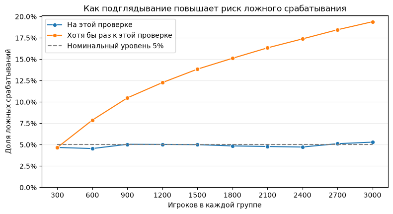

# Cookie Cats — A/B-тестирование и симуляция экспериментов

Следует ли переносить ворота в мобильной игре с 30-го на 40-й уровень? Проект оценивает разницу удержания между вариантами и показывает, как многократные проверки результатов меняют частоту ложных срабатываний.

## Результаты

**Рекомендация — сохранить ворота на 30-м уровне.** В группе `gate_40` наблюдаемое D7 ниже на **0,82 п.п.**, или примерно на 8 возвратов на седьмой день на 1 000 игроков.

| Метрика | `gate_30` | `gate_40` | Разность, п.п. | 95%-й ДИ Ньюкомба, п.п. | p-value |
| --- | ---: | ---: | ---: | ---: | ---: |
| **D7** | 19,02% | 18,20% | **−0,82** | **[−1,33; −0,31]** | **0,00155** |
| D1 | 44,82% | 44,23% | −0,59 | [−1,24; +0,06] | 0,07441 |

Разности рассчитаны в порядке `gate_40 − gate_30`. D7 — основная метрика, D1 — дополнительная. Для D7 процентильный bootstrap дал близкий интервал **[−1,34; −0,31] п.п.**

Плановая пропорция назначения неизвестна. При допущении 50/50 проверка SRM дала p-value = 0,0086. Это ограничивает причинную интерпретацию различий. Экономическая значимость требует данных о ценности игроков и продуктового порога. Подробности — в [бизнес-отчёте](docs/business_report.md).

## Симуляция подглядывания

На **10 000 синтетических экспериментах без истинного эффекта** сравниваются одна финальная проверка и остановка при первом значимом результате из десяти накопительных проверок. В каждой группе 3 000 игроков, вероятность возврата 20%, уровень значимости 5%, seed 2026.

На одних и тех же симулированных данных частота ложных срабатываний составила **5,30%** при одной финальной проверке и **19,39%** при подглядывании. Результат относится к выбранному расписанию проверок. Расписание исходного эксперимента Cookie Cats неизвестно.



## Методология и материалы

- [Экспериментальный дизайн](docs/experiment_design.md) — продуктовая гипотеза, метрики, MDE и чувствительность размера выборки. Дизайн учебный и ретроспективный, параметры планирования иллюстративные.
- [Аудит и EDA](notebooks/01_data_audit_eda.ipynb) — 90 189 игроков, проверки пропусков, уникальности, допустимых значений, SRM и описание активности.
- [Статистический анализ](notebooks/02_hypothesis_testing.ipynb) — разности долей, относительные изменения, двусторонние z-тесты, интервалы Ньюкомба и bootstrap.
- [Симуляция](notebooks/03_simulation_results.ipynb) — ошибка I рода при фиксированном горизонте и подглядывании.
- [Модуль симуляции](src/ab_testing/simulation.py) и [расчёт выборки](scripts/sample_size.py) — воспроизводимые вычисления.

Число раундов измерено после назначения группы. Сравнения активности описательные. В анализ удержания игроки входят по назначенным группам независимо от числа сыгранных раундов.

## Стек

Python 3.12, Pandas, NumPy, SciPy, Statsmodels, Matplotlib, Seaborn, Jupyter и uv. Версии зависимостей зафиксированы в `uv.lock`.

## Воспроизведение

Понадобятся Git, [uv](https://docs.astral.sh/uv/getting-started/installation/) и редактор с поддержкой Jupyter, например VS Code с расширением Jupyter.

1. Клонируйте репозиторий и установите окружение из lock-файла.

   ```bash
   git clone https://github.com/ekt4r/cookie-cats-ab-testing.git
   cd cookie-cats-ab-testing
   uv sync --locked
   ```

2. Скачайте [Cookie Cats A/B Testing Dataset](https://www.kaggle.com/datasets/yufengsui/mobile-games-ab-testing) и распакуйте `cookie_cats.csv` в `data/raw/`. Исходный CSV исключён из Git.

3. Откройте ноутбуки в порядке `01` → `02` → `03`, выберите Python из `.venv` и выполните все ячейки. Ноутбуки запускаются из корня проекта или папки `notebooks/`. Пакет `ab_testing` устанавливается командой `uv sync`.

Расчёт размера выборки и симуляцию также можно запустить из корня проекта:

```bash
uv run --locked python scripts/sample_size.py
uv run --locked python -m ab_testing.simulation
```

Ноутбук `03` и модуль симуляции работают на синтетических данных и доступны без CSV. В ноутбуках сохранены результаты выполненных ячеек.
